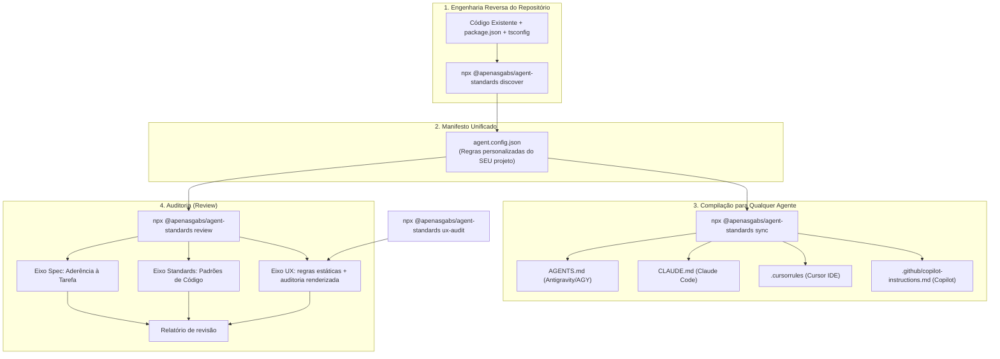

# 🛡️ Universal Agent Standards Engine

> **Discover, generate, and enforce custom coding & architecture standards across Antigravity (AGY), Claude Code, Cursor, GitHub Copilot, and CI/CD pipelines.**

[](https://opensource.org/licenses/MIT)
[](https://nodejs.org/)
[-blue.svg)](https://skills.sh)
[](https://docs.anthropic.com/en/docs/agents-and-tools/claude-code/overview)
[](https://cursor.com)

---

## 🌪️ O Problema: O "Zoológico" de Regras de IA e o Drift de Padrões

Com o avanço dos agentes de codificação, cada ferramenta inventou seu próprio formato de regras:
- Antigravity / AGY usam `AGENTS.md` e skills.
- Claude Code usa `CLAUDE.md`.
- Cursor usa `.cursorrules`.
- GitHub Copilot usa `.github/copilot-instructions.md`.

Isso gera três grandes problemas para times e desenvolvedores:
1. **Drift de Padrões**: Uma melhoria de regras feita em uma ferramenta não é replicada nas outras.
2. **Falta de Customização**: Ferramentas existentes tentam forçar um padrão opinativo e rígido ("todo mundo tem que programar igual"), gerando atrito e rejeição em projetos legados.
3. **Revisões Cegas**: Linters analisam sintaxe, mas não avaliam se o código entregue pela IA **realmente implementou o que foi pedido na issue/tarefa**.

---

## ✨ A Solução: Universal Agent Standards Engine

O **`agent-standards`** atua como uma **Single Source of Truth (SSOT)** customizável e inteligente:



---

## 🚀 Início Rápido (Quickstart)

Sem necessidade de cadastros, assinaturas ou chaves pagas:

### 1. Inicializar no seu Repositório Atual
```bash
npx @apenasgabs/agent-standards init
```
*O motor inspeciona seu repositório, identifica suas dependências e estilo de código, gera o `agent.config.json` e compila todos os arquivos de agentes automaticamente.*

### 2. Apenas Inspecionar o Perfil Técnico
```bash
npx @apenasgabs/agent-standards discover
```

### 3. Sincronizar Regras entre Todas as IAs
```bash
npx @apenasgabs/agent-standards sync
```

### 4. Executar Code Review na Branch Ativa
```bash
npx @apenasgabs/agent-standards review --base origin/main
```

### 5. Auditar a UI Renderizada (quando a mudança toca interface)
```bash
BROWSERLESS_HOST=<host:porta> BROWSERLESS_TOKEN=<token> npx @apenasgabs/agent-standards ux-audit --routes /,/conta
```

---

## 📦 Presets Nativos Inclusos

O motor vem com presets de referência baseados em arquiteturas consagradas:

| Preset | Stack / Foco | Principais Diretrizes |
|---|---|---|
| **`frontend-react`** | React 19 / Next.js / Vite | Arrow functions obrigatórias, proibição de `any`, `data-testid` em botões/inputs, daisyUI/Tailwind prioritário, bloqueio de XSS. |
| **`scraping-crawler`** | SimpleCrawl / Playwright / Cheerio | Estratégia **HTTP-first, browser-fallback** (Cheerio para SSR, Playwright para CSR), arquitetura modular `BaseScraper` com separação de seletores e mappers. |
| **`java-spring`** | Java 17+ / Maven / Gradle / Spring Boot | Arquitetura em camadas (`Controller ➔ Service ➔ Repository ➔ Model`), DTOs em Records, Bean Validation, SLF4J sem `System.out`, JUnit 5. |
| **`go-service`** | Go Modules / Gin / Fiber / Echo / CLI | Erros idiomáticos (`if err != nil`, `%w`), `context.Context` como 1º parâmetro, `signal.NotifyContext`, `sync.WaitGroup`, logger estruturado (`logrus`/`slog`). |
| **`minimal`** | Qualquer stack / Universal | Higiene de código, remoção de `console.log` residual, tratamento adequado de `catch` e bloqueio de credenciais hardcoded. |

---

## 🛠️ Customização: O `agent.config.json`

Você tem controle total sobre as regras que seu time deseja aplicar:

```json
{
  "$schema": "https://raw.githubusercontent.com/ApenasGabs/agent-standards/main/schema.json",
  "preset": "frontend-react",
  "rules": {
    "functions": "arrow-only",
    "typescript": {
      "noExplicitAny": true,
      "preferInterfaces": true
    },
    "ui": {
      "preferred": "daisyui",
      "requireDataTestId": true
    },
    "security": {
      "blockInnerHTML": true,
      "blockHardcodedSecrets": true
    },
    "cleanCode": {
      "blockConsoleLog": true,
      "blockEmptyCatch": true
    }
  },
  "docsSync": ["AGENTS.md", "CLAUDE.md", ".github/copilot-instructions.md", ".cursorrules"]
}
```

### Exceções por pasta

```json
{
  "overrides": [
    { "paths": ["src/**"], "rules": { "cleanCode": { "blockConsoleLog": false } } }
  ]
}
```

O revisor verifica `functions`, `typescript.noExplicitAny`, `ui.requireDataTestId`, `security.blockInnerHTML`, `security.blockHardcodedSecrets`, `cleanCode.blockConsoleLog`, `cleanCode.blockEmptyCatch` e as regras `ux.*` (veja [Eixo UX](#-eixo-ux)). Outras regras servem à documentação e aparecem no relatório como não verificadas.

A avaliação usa a configuração da branch base, para que uma entrega não afrouxe as próprias regras.

| Status | Saída | Significado |
|---|---|---|
| 🟢 Aprovado | 0 | Nada pendente |
| 🟡 Pendente de Confirmação | 0 | Há requisito, aviso ou CI a confirmar por revisão |
| 🔴 Reprovado / Requer Ajustes | 1 | Violação grave ou CI falhando |
| 🔴 Reprovado / Revisão Inconclusiva | 2 | Diff vazio, base inexistente, configuração inválida ou issue ilegível |

O `review` não gera mais `review-fixes.patch`, porque o patch não era aplicável. O `sync` preserva documentos escritos à mão, salvo com `--force`.

---

## 🌐 Perfis Globais (regras gerais para muitos repositórios)

Configurar repositório por repositório não escala. Um **perfil** reúne as regras gerais num lugar só (`profiles/` deste pacote) e vale para qualquer repo, com ou sem `agent.config.json`:

```bash
npx @apenasgabs/agent-standards review --profile kraken --ux-audit auto
# ou: AGENT_STANDARDS_PROFILE=kraken npx @apenasgabs/agent-standards review
```

Precedência: **perfil < regras deduzidas da documentação < `agent.config.json` da branch base**. Regra deduzida como `false` (a doc só não menciona) não desliga o perfil; só o `agent.config.json` desliga, inclusive o gate de UX com `"ux": false`.

O perfil `kraken` liga o Eixo UX inteiro (regras estáticas + gate renderizado com `baseUrl`, `themes` e `login` em `"auto"`), bloqueio de segredos e de `catch` vazio. Estilo de código (arrow functions, `any`) continua vindo de cada repositório. Mudar uma regra geral é um PR aqui; todos os repos passam a segui-la.

---

## 🔁 Retrabalho automático no Paperclip (`--dispatch`)

```bash
npx @apenasgabs/agent-standards review --profile kraken --ux-audit auto --task 42 --dispatch
```

Com status 🔴 e autoria de agente de IA, o review abre uma issue de retrabalho no Paperclip, só com os bloqueios (arquivo e linha, CI falhando, motivos de inconclusivo), atribuída ao agente configurado e já acordado. A autoria vem do autor, da branch ou da mensagem do último commit (palavras inteiras como `forge`, `sentinel`, `[bot]`, `APE-123`); force com `--author ai|human`.

| Variável | Uso |
|---|---|
| `PAPERCLIP_URL` | Endereço do Paperclip |
| `PAPERCLIP_API_KEY` ou `PAPERCLIP_TOKEN_FILE` | Token (direto ou arquivo) |
| `PAPERCLIP_COMPANY_ID`, `PAPERCLIP_PROJECT_ID` | Onde a issue é criada |
| `PAPERCLIP_DISPATCH_AGENT_ID` | Agente que recebe o retrabalho |

Variável ausente não quebra o review: o despacho é pulado com o motivo.

`--task` aceita número da issue, arquivo de spec relativo ao repositório (`--task docs/specs/login.md`) ou texto livre.

**Migração do revisor legado do Kraken**: o script antigo em `/workspace/.agents/scripts` pode virar um repasse fino para `review --profile kraken --ux-audit auto`, mantendo caminho e flags (`--target`, `--task`, `--base`, `--dispatch`).

---

## 🎨 Eixo UX

Interface ruim raramente aparece no diff: ela aparece na tela. O Eixo UX tem três camadas.

### 1. Regras estáticas (no `review`)

| Regra (`rules.ux.*`) | Severidade | O que acusa |
|---|---|---|
| `blockImportant` (alias `ui.noImportant`) | 🔴 | `!important` em CSS ou estilo inline |
| `blockHardcodedColors` | 🟡 | Hex/`rgb()`/`hsl()` fora de definição de token (`--cor: #fff` é permitido) e cores arbitrárias do Tailwind (`text-[#333]`) |
| `blockSlopPatterns` | 🟡 | Estética genérica de IA: gradiente roxo/rosa, `backdrop-blur`, `shadow-2xl`/glow, `border-l-4`, `bg-clip-text` |
| `blockEmojiInUi` | 🟡 | Emoji em texto JSX/markup e em `aria-label`, `title`, `placeholder`, `alt`, `label` |
| `requireAccessibleIconButton` | 🟡 | `<button>`/`<IconButton>` só com ícone e sem `aria-label`/`title`/`sr-only` |

Use `overrides` para liberar cores no arquivo de tokens.

### 2. Auditoria renderizada (`ux-audit`)

Renderiza cada rota × tema × viewport (375×812, 768×1024, 1440×900 por padrão) e mede:

- 🔴 overflow horizontal, exceção não tratada, rota que não carrega ou redireciona para o login, viewport não aplicada;
- 🟡 alvos de toque abaixo de 44×44px (só em viewport touch), elemento interativo sem nome acessível, imagem sem `alt`, contraste abaixo de 4.5:1 (3:1 em texto grande) e `console.error`.

Saída em `.ux-review/` (adicione ao `.gitignore`): `UX_AUDIT.md`, `ux-report.json` e um PNG por combinação. Configure na seção `ux` do `agent.config.json`:

```json
{
  "ux": {
    "baseUrl": "https://app.exemplo.dev",
    "routes": ["/", { "path": "/conta", "waitFor": "[data-testid=conta]" }],
    "themes": [
      { "name": "light", "localStorage": { "theme": "light" }, "attributes": { "data-theme": "light" }, "colorScheme": "light" },
      { "name": "dark", "localStorage": { "theme": "dark" }, "attributes": { "data-theme": "dark" }, "colorScheme": "dark" }
    ],
    "login": {
      "path": "/login",
      "fields": { "[data-testid=login-email]": "UX_AUDIT_EMAIL", "[data-testid=login-password]": "UX_AUDIT_PASSWORD" },
      "submit": "[data-testid=login-submit]",
      "waitFor": "[data-testid=app-shell]"
    }
  }
}
```

`login.fields` mapeia seletor → **nome** da variável de ambiente; nenhum segredo vai para o arquivo. O login roda uma vez e a sessão é reaproveitada em todas as combinações.

| Variável | Uso |
|---|---|
| `BROWSERLESS_HOST`, `BROWSERLESS_TOKEN` | Navegador remoto pelo protocolo Playwright (`ws://host/chromium/playwright`) |
| `AGENT_STANDARDS_BROWSER_WS` | Endpoint Playwright completo, quando não é Browserless |
| `AGENT_STANDARDS_CDP_URL` | Força CDP. Evite: o Browserless ignora a viewport do contexto via CDP, e a guarda `ux-viewport-mismatch` reprova a combinação |

`--local` usa o Chromium da máquina. O cliente `playwright-core` é procurado no projeto, no pacote e nos módulos globais, e a versão mais nova é usada: servidores remotos recusam clientes antigos. Se a conexão cair ou travar, o comando sai com código 2 em vez de "passar" sem auditar.

| Saída | Significado |
|---|---|
| 0 | Sem achado grave (pode haver 🟡 para o revisor avaliar) |
| 1 | Há achado 🔴 |
| 2 | A auditoria não rodou (config, conexão, login) |

### Descoberta automática (sem configuração por projeto)

| Valor `"auto"` | Como funciona |
|---|---|
| `baseUrl` | Usa o preview publicado para o commit (deployments do GitHub, ex.: Vercel). Sem preview, informe `--url` |
| `themes` | `light` e `dark` aplicando ao mesmo tempo `prefers-color-scheme`, `data-theme`, classe `dark` do `<html>` e `localStorage.theme`. Se os dois renderizam o mesmo fundo, o audit acusa 🟡 `ux-theme-not-applied` em vez de fingir cobertura |
| `login` | Com `UX_AUDIT_EMAIL` e `UX_AUDIT_PASSWORD` no ambiente, acha o formulário pelo campo de senha, entra e reaproveita a sessão. Sem credenciais, rotas com login geram 🟡 `ux-login-required` |

Preview protegido da Vercel: defina `VERCEL_AUTOMATION_BYPASS_SECRET` e o audit envia o header de bypass. Cores em `oklch()`/`lab()` (Tailwind v4, daisyUI 5) são convertidas pelo navegador antes do cálculo de contraste.

`review --ux-audit auto` roda o `ux-audit` sozinho quando o diff toca UI e não há auditoria do commit; sem preview ou navegador, registra o motivo no relatório (o status fica 🟡, nunca 🟢).

### 3. Gate no `review` e revisor de UX

Com a seção `ux` no `agent.config.json` **da branch base**, toda mudança em arquivo de UI exige `ux-report.json` do mesmo commit. Sem ele (ou com relatório de outro commit) o status fica 🟡; achados 🔴 renderizados reprovam. Remover a seção `ux` na própria entrega não dispensa a auditoria.

O que não é mensurável (hierarquia, slop visual, microcopy, estados, fluxo) fica com a skill [`skills/ux-reviewer`](skills/ux-reviewer/SKILL.md): um revisor independente que abre os screenshots e emite parecer binário, sem editar código.

---

## 🤖 Uso como Skill no Antigravity / skills.sh

Se você utiliza o **Antigravity (AGY)** ou ferramentas compatíveis com o padrão aberto do [skills.sh](https://skills.sh):

```bash
# Adicionar a skill ao seu ambiente
npx skills add ApenasGabs/agent-standards
```

O subagente `spec-code-reviewer` ficará disponível para auditar qualquer repositório no seu ambiente, respeitando rigorosamente o `agent.config.json` local.

---

## 🧱 Automação no CI/CD (GitHub Action Reutilizável)

Adicione a auditoria automática de PRs no seu repositório em `.github/workflows/spec-review.yml`:

```yaml
name: Spec & Standards Review

on: [pull_request]

jobs:
  review:
    runs-on: ubuntu-latest
    steps:
      - uses: actions/checkout@v4
        with:
          fetch-depth: 0
      - uses: actions/setup-node@v4
        with:
          node-version: 20
      - name: Run Code Review
        run: npx @apenasgabs/agent-standards review --base origin/main
```

---

## 📄 Licença

Distribuído sob a licença [MIT](./LICENSE). Desenvolvido por [Gabriel Rodrigues (@ApenasGabs)](https://github.com/ApenasGabs).
